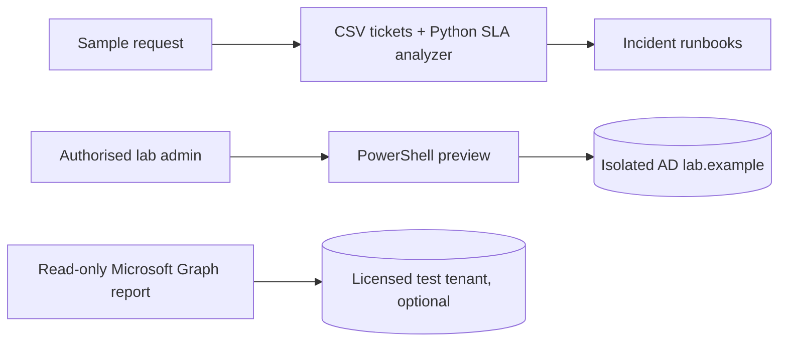

# Enterprise IT Support & Endpoint Management Lab

A reproducible IT-support project combining an **offline ticket and SLA analyzer**, controlled Active Directory user-lifecycle PowerShell templates, a read-only Intune device-compliance exporter, and troubleshooting runbooks.

> **Status:** Offline ticket-analysis code and unit tests are implemented. AD and Intune scripts are supplied for controlled testing only. No real tenant, production domain, device fleet or help-desk environment was accessed during the creation of this repository.

## What is implemented

| Component | Evidence | Scope |
|---|---|---|
| Ticket/SLA analyzer | Python CLI, validation, unit tests, synthetic incidents | Executable offline |
| Windows onboarding | `scripts/Invoke-LabJoiner.ps1` | Preview by default; restricted to a `lab.example` test domain |
| Windows offboarding | `scripts/Invoke-LabLeaver.ps1` | Preview by default; explicit approval required |
| ServiceNow incidents | `scripts/Get-ServiceNowIncidents.ps1` | Read-only table API; approved OAuth token required |
| Endpoint compliance | `scripts/Get-IntuneDeviceCompliance.ps1` | Microsoft Graph read-only; tenant/license required |
| Diagnostics | `scripts/Get-WorkstationDiagnostics.ps1` | Read-only Windows workstation diagnostics |
| Support runbooks | `docs/runbooks/` | Identity, device compliance and AV troubleshooting |

## Run the offline working example

```bash
python -m unittest discover -s tests -v
python -m itsupport_lab report --file sample-data/incidents.csv --as-of 2026-11-19T12:00:00Z
```

Create a styled standalone report with:

```bash
python -m itsupport_lab report --file sample-data/incidents.csv --as-of 2026-11-19T12:00:00Z --format html --output reports/example.html
```

The sample consists of eight deliberately **fictional** tickets. The analyzer reports status counts, elapsed-clock-hour targets, breaches and resolution outcomes. SLA thresholds are illustrative, not a claim about a particular employer's agreed service levels.

## Lab architecture



## Test and safety approach

- No embedded tokens, secrets, private tenant identifiers, production exports or personal records.
- AD scripts require a dedicated disposable `lab.example` forest and explicit `-Apply`; no write occurs by default.
- Intune reporting requests only `DeviceManagementManagedDevices.Read.All`, subject to administrative consent and licensing. See [Microsoft's managedDevice documentation](https://learn.microsoft.com/en-us/graph/api/intune-devices-manageddevice-list?view=graph-rest-1.0).
- Sample data is synthetic and must not be presented as employment incident metrics.
- Run `python -m unittest discover -s tests -v` to reproduce the offline test suite.

## Documentation

- [Step-by-step environment setup](docs/lab-setup.md)
- [Password and identity issues](docs/runbooks/password-reset.md)
- [Endpoint compliance triage](docs/runbooks/endpoint-noncompliance.md)
- [Meeting-room AV incident](docs/runbooks/meeting-room-incident.md)

## Next evidence milestone

Deploy the **separate** Windows/Intune test environment, run the PowerShell scripts safely, capture redacted evidence and record the actual results. Until then, the work should be described as an implemented offline analyzer with prepared admin automation rather than an operational enterprise environment.
